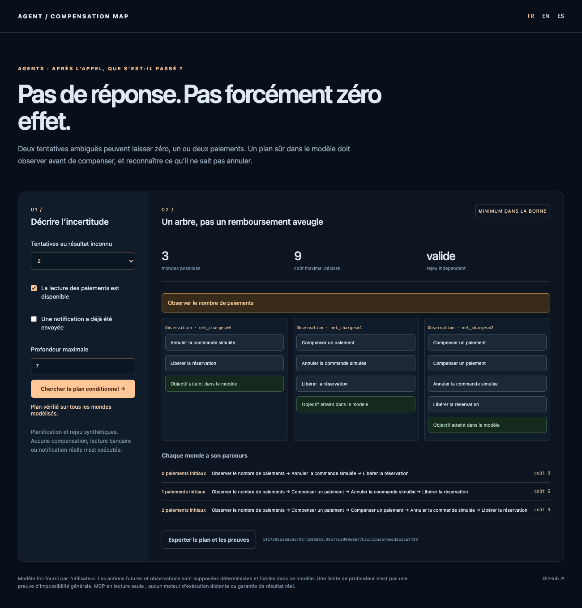

# Agent Compensation Map

[English](README.en.md) · [Español](README.es.md)

**Après deux appels sans réponse, il peut y avoir zéro, un ou deux effets. « Annuler » demande parfois d’observer d’abord.**

Le moteur reconstruit les mondes possibles d’une trace, calcule un arbre conditionnel de compensation et rejoue séparément chaque branche. Il planifie **sans exécuter d’action externe**. Une notification déjà envoyée ne se transforme jamais en faux bouton « désenvoyer ».



## Essayer

Python 3.11 ou supérieur, bibliothèque standard uniquement ; aucune clé.

```sh
python3 -m compensation_map serve --lang fr
```

Ouvrir `http://127.0.0.1:8769/?lang=fr`. Deux tentatives de paiement ambiguës produisent trois mondes. Le plan lit leur nombre, compense zéro/une/deux fois selon l’observation, puis annule la commande simulée et libère le stock. Coût maximal déclaré : **9 unités**, vérifié dans chaque monde. Couper l’observation ou activer la notification irréversible fait apparaître le besoin de revue.

```sh
python3 -m compensation_map demo > preuve.json
python3 -m compensation_map plan compensation_map/examples/ambiguous-charge.json
```

`pip install .` fournit aussi `compensation-map`. Interface et messages CLI en FR/EN/ES ; identifiants d’actions conservés.

## Modèle de compensation

- `domains` et `initial` définissent des faits finis typés ; booléens et entiers ne sont pas confondus.
- `operations` décrit les effets d’origine. Une trace `confirmed` confirme l’effet, `unknown` conserve les deux possibilités, `not_applied` confirme l’absence d’effet et `not_started` indique une opération non démarrée. Une erreur réseau doit rester **unknown**, pas être supposée sans effet.
- `compensations` contient uniquement les opérations déclarées, leurs préconditions et coûts. Aucune inverse n’est inventée.
- `observations` révèle des faits et crée les branches du plan ; les préconditions des actions doivent tenir dans tous les mondes de leur branche.
- `goal` indique l’état recherché. Les faits observés peuvent réduire l’incertitude ; une observation contradictoire est rejetée.

La recherche AND/OR minimise le **coût du pire parcours dans la profondeur fournie**, sans supposer de probabilités sur les mondes. Le vérificateur parcourt chaque monde initial avec un interprète distinct, contrôle les préconditions et le but, puis recalcule les coûts. La preuve exportée contient le cas source, sa SHA-256, l’arbre et tous les parcours.

`minimum_cost_within_depth_proven` ne vaut vrai que si l’exploration bornée est terminée. Une limite de profondeur ou de calcul n’est pas une impossibilité générale. Si un but exige de modifier un fait qu’aucune compensation ne touche, un témoin explique cette impossibilité **dans le modèle déclaré**.

## Outil MCP en lecture seule

```sh
python3 -m compensation_map mcp
```

Configurer le client avec le chemin absolu de son Python installé :

```json
{
  "mcpServers": {
    "compensation-map": {
      "command": "/path/to/venv/bin/python",
      "args": ["-m", "compensation_map", "mcp"]
    }
  }
}
```

L’outil `compensation_plan` accepte `{ "case": ... }` et renvoie une sortie structurée. Il est annoté en lecture seule, sans effet destructeur ni monde externe. L’initialisation, la liste et l’appel ont été testés avec le **SDK MCP officiel 1.32.1**, au protocole 2025-11-25. Les installations réelles OpenClaw et Hermes restent à vérifier ; aucun adaptateur ne convertit automatiquement leurs erreurs en traces de ce modèle.

## Existant et limites

[Temporal documente déjà les sagas et compensations](https://temporal.io/blog/compensating-actions-part-of-a-complete-breakfast-with-sagas). La [planification conditionnelle](https://unified-planning.readthedocs.io/en/latest/plan_representation.html) existe également. Ce projet ne revendique aucune invention de ces méthodes : sa démo rend visible **résultat ambigu → croyances → observation nécessaire → compensation conditionnelle → rejeu indépendant**. Il complète le journal d’[Agent Commerce Ledger](https://github.com/gbesse/agent-commerce-ledger) et la revue avant appel de [Jev Proxy](https://github.com/gbesse/jev-proxy).

Au plus douze faits, douze étapes de trace, soixante-quatre mondes et neuf niveaux de recherche. Les effets et lectures futurs sont supposés déterministes et fiables dans le modèle ; concurrence externe, autorisation humaine et échecs de compensation ne sont pas résolus. Les coûts sont déclarés, sans mesure de latence ou d’argent réel. L’exemple est synthétique ; aucun paiement, message ou stock réel n’est modifié. Ni restauration de production ni supériorité SOTA ne sont démontrées.

## Vérifier

```sh
python3 -m unittest discover -s tests -v
npm ci
npx playwright install chromium
npm run test:browser
npm run test:mcp
npm run format:check
```

Treize tests couvrent croyances, branches, coût, irréversibilité, profondeur, observations incohérentes et MCP stdio. Tests supplémentaires avec SDK MCP officiel ; navigateur FR/EN/ES et mobile ; CI Python 3.11/3.12 et roue hors sources. Code 1 si une revue est requise, 2 pour une entrée non valide. Licence MIT, alpha de recherche.
